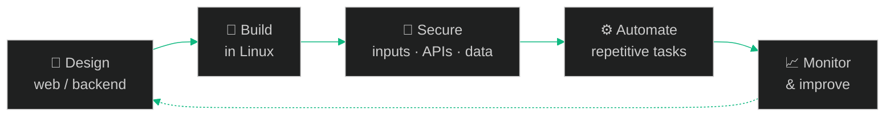

<div align="center">


<br/>


<br/><br/>


</div>


<h2 align="center">👤 Profile</h2>

```yaml
Name: Shivu Kumar A M
Core Identity:
  - Linux
  - Full Stack Web Developer
  - Cyber Security Enthusiast
Primary Languages: Python, JavaScript, Bash
Backend Focus: Django, FastAPI, Node.js
Databases: PostgreSQL, MySQL, MongoDB
Mindset: Build → Secure → Automate
```


<h2 align="center">🧠 How the Three Areas Connect</h2>

<div align="center">

| 🐧 Linux | 🌐 Web Development | 🔐 Cyber Security |
| :---: | :---: | :---: |
| **Control** of the system | **Build** products | **Survive** real-world use |

*I don't treat these as separate roles — they reinforce each other.*

</div>


<h2 align="center">🛠️ Tech Stack</h2>

<div align="center">

<sub><b>LANGUAGES & SYSTEMS</b></sub><br/>


<br/><br/>

<sub><b>WEB & BACKEND</b></sub><br/>


<br/><br/>

<sub><b>DATABASES & DEVOPS</b></sub><br/>


</div>


<h2 align="center">🚀 Projects</h2>

<table align="center">
<tr>
<td width="50%" valign="top">

#### ☣️ Malware Analysis Engine
Static malware inspection & analysis system<br/>
`Python` · `Linux`

</td>
<td width="50%" valign="top">

#### 🔐 Encryption Manager
AES-256 encryption & key management tool<br/>
`Java` · `Cryptography`

</td>
</tr>
<tr>
<td valign="top">

#### 🚗 DreamCars Rental
Full-stack vehicle rental & management portal<br/>
`PHP` · `MySQL`

</td>
<td valign="top">

#### 🤖 SDIT / Gemini Automation
CLI & web automation for institutional workflows<br/>
`Python` · `Node.js`

</td>
</tr>
<tr>
<td valign="top">

#### 👁️ FaceCapture AI
Biometric authentication prototype<br/>
`JavaScript` · `OpenCV`

</td>
<td valign="top">

#### 🌐 CivicSense
Secure civic issue reporting web platform<br/>
`Node.js` · `React` · `PostgreSQL`

</td>
</tr>
</table>


<h2 align="center">🧪 How I Usually Work</h2>



<div align="center"><sub>Applies to a <b>web app</b>, a <b>Linux service</b>, or a <b>security tool</b>.</sub></div>


<h2 align="center">📊 GitHub Activity</h2>

<div align="center">


</div>


<h2 align="center">🎯 Currently Improving</h2>

<div align="center">

| Advanced backend patterns | Linux internals & optimization | Secure web architectures | Python automation & tooling |
| :---: | :---: | :---: | :---: |
| 🧱 | 🐧 | 🛡️ | 🐍 |

</div>


<div align="center">

<h2>📡 Connect</h2>

<a href="https://www.linkedin.com/in/shivu-kumar-a-m"></a>
<a href="https://github.com/Shivukumar-M"></a>

<br/><br/>


<sub>⭐ <b>Linux • Web Development • Cyber Security</b> ⭐<br/>© 2026 Shivu Kumar A M</sub>


</div>
