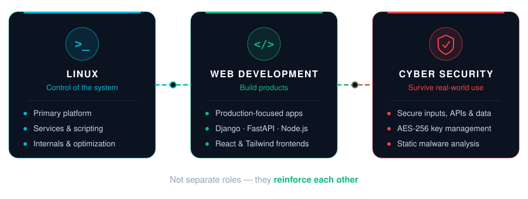
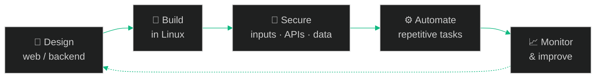

 

  

<h2 align="center">🧠 How the Three Areas Connect</h2>

  

## 🛠️ Tech Stack & Environment

### ⚡ Languages & Systems

  

### 🌐 Web & Backend

  

### 🗄️ Databases & DevOps

  

---

<h2 align="center">🚀 Projects</h2>

<h4 align="center">🔐 Security &nbsp;·&nbsp; 🌐 Web &nbsp;·&nbsp; 🤖 Automation</h4>

## 🚀 Projects

<table width="100%" style="width:100%; table-layout:fixed; border-collapse:collapse;">
<tr>
<td width="50%" valign="top">

### ☣️ Malware Analysis Engine

Static malware inspection & analysis system

</td>
<td width="50%" valign="top">

### 🔐 Encryption Manager

AES-256 encryption & key management tool

</td>
</tr>

<tr>
<td width="50%" valign="top">

### 🚗 DreamCars Rental

Full-stack vehicle rental & management portal

</td>
<td width="50%" valign="top">

### 🤖 SDIT / Gemini Automation

CLI & web automation for institutional workflows

</td>
</tr>

<tr>
<td width="50%" valign="top">

### 👁️ FaceCapture AI

Biometric authentication prototype

</td>
<td width="50%" valign="top">

### 🌐 CivicSense

Secure civic issue reporting web platform

</td>
</tr>
</table>

<h2 align="center">🧪 How I Usually Work</h2>

Applies to a <b>web app</b>, a <b>Linux service</b>, or a <b>security tool</b>.

<h2 align="center">📊 GitHub Activity</h2>

<h2 align="center">🎯 Currently Improving</h2>

| Advanced backend patterns | Linux internals & optimization | Secure web architectures | Python automation & tooling |
| :---: | :---: | :---: | :---: |
| 🧱 | 🐧 | 🛡️ | 🐍 |

<h2>📡 Connect</h2>

  

⭐ <b>Linux • Web Development • Cyber Security</b> ⭐ © 2026 Shivu Kumar A M

